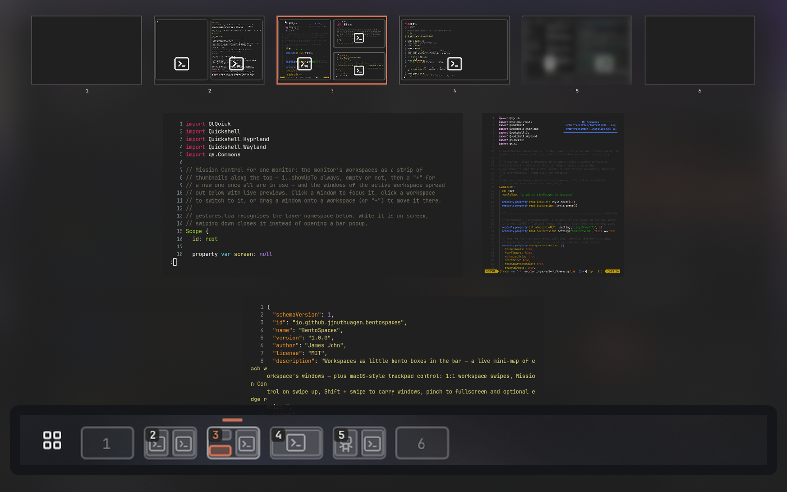
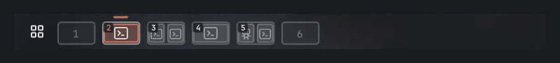
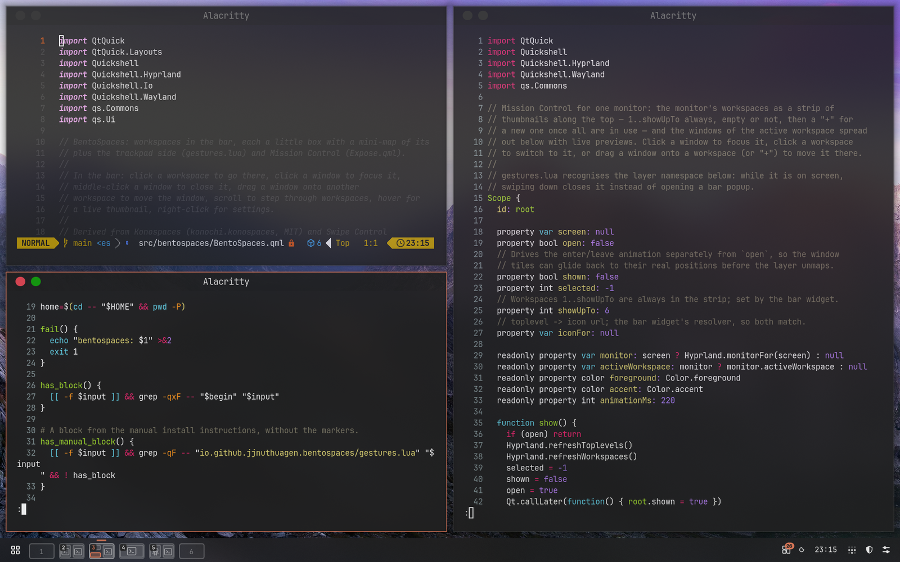
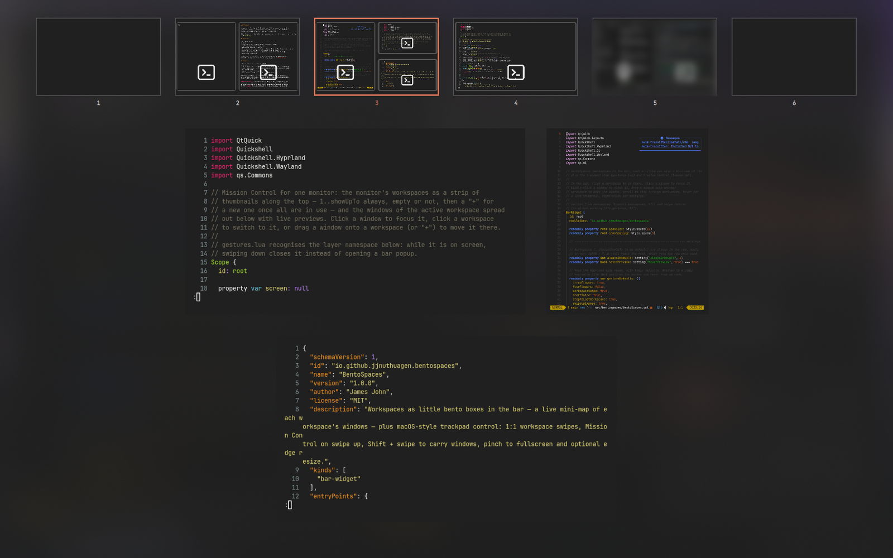
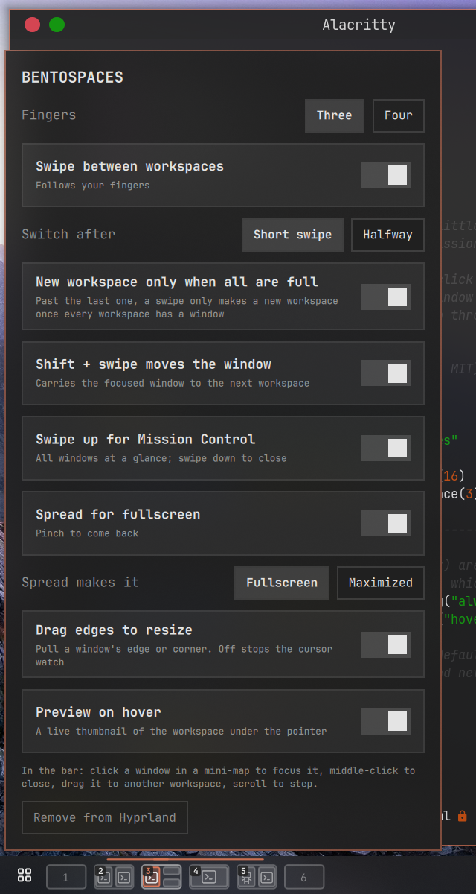

# BentoSpaces

Workspaces for Omarchy, as little bento boxes. Each workspace in the bar is a
tiny screen showing its windows where they really are, with their app icons —
and the trackpad moves you around them the way macOS does.





## In the bar

| Do | What happens |
|---|---|
| Click a workspace | Go there (special workspaces toggle) |
| Click a window in a box | Focus it |
| Middle-click a window | Close it |
| Drag a window onto another workspace | Move it there, without leaving where you are |
| Scroll over the row | Step to the previous / next workspace |
| Hover a workspace | Snapshot of the workspace and its window titles |
| Right-click | Settings |

The workspace you are on gets the bar's own accent mark, sliding across as
you switch. Workspaces 1–6 are always shown, empty or not (`alwaysShowUpTo`).



## Trackpad

| Gesture | Normally | In Mission Control |
|---|---|---|
| Left / right | Switch workspace, 1:1 with your fingers | Switch workspace |
| Shift + left / right | Carry the focused window to the next workspace | same |
| Up | Mission Control | — |
| Down | — | Close Mission Control |
| Spread / pinch | Fullscreen the focused window / back | — |

Workspaces 1–6 always exist, and a new one past the last is only made once
every workspace has a window — swiping right on an empty last workspace stops
instead of making another.

**Mission Control** shows every workspace along the top (live previews, with
app icons) and the windows of the current one below. Click a window to focus
it, click a thumbnail to go there, drag a window onto a thumbnail to move it —
or onto **+ New** once every workspace is in use. Arrow keys, Tab and Enter
work too; Escape or a click on empty space closes it.



## Settings



Right-click the workspaces. Every switch applies at once, without reloading
Hyprland: three / four fingers, workspace swipe, short swipe (macOS-style
threshold), new workspace only when all are full, Shift + swipe, swipe up for
Mission Control, spread for fullscreen (or maximise), drag edges to resize,
and hover preview.

Two settings live only in the widget's entry in `~/.config/omarchy/shell.json`:

| Key | Default | Meaning |
|---|---|---|
| `alwaysShowUpTo` | `6` | Workspaces 1..n always shown and kept alive |
| `iconPack` | `""` | An icon theme under `~/.local/share/icons` to take app icons from first |

```sh
omarchy bar set io.github.jjnuthuagen.bentospaces alwaysShowUpTo 8 --json
omarchy bar set io.github.jjnuthuagen.bentospaces iconPack Tabler-Ember
```

<br clear="right">

## Install

Requires Omarchy with the plugin shell (Quattro) and Hyprland 0.55+ with the
Lua config; a touchpad for the gestures.

```sh
omarchy plugin add https://github.com/jjnuthuagen/bentospaces --enable
omarchy plugin disable omarchy.workspaces   # BentoSpaces replaces it
```

Then right-click the workspaces and press **Enable in Hyprland**. That runs
the plugin's `setup.sh`, which backs up `~/.config/hypr/input.lua`, appends a
marked block that loads `gestures.lua`, and reloads Hyprland. Or by hand:

```sh
~/.config/omarchy/plugins/io.github.jjnuthuagen.bentospaces/setup.sh enable   # or: status, disable
```

Remove any `hl.gesture(...)` lines of your own on the same finger count —
Hyprland allows one gesture per finger count and direction.

## Optional extras

Not part of the plugin; add to `~/.config/hypr/bindings.lua` if you like.

```lua
-- Mission Control on a key
o.bind("SUPER + E", "Mission Control", "omarchy-shell -q io.github.jjnuthuagen.bentospaces toggleExpose")

-- SUPER + CTRL + arrows with the same "new only when all are full" rule
hl.unbind("SUPER + CTRL + LEFT")
hl.unbind("SUPER + CTRL + RIGHT")
o.bind("SUPER + CTRL + LEFT", "Workspace left", function() if BentoSpaces then BentoSpaces.step(-1) end end)
o.bind("SUPER + CTRL + RIGHT", "Workspace right", function() if BentoSpaces then BentoSpaces.step(1) end end)

-- Only six workspaces: drop SUPER + 7..0
for ws = 7, 10 do
  local key = "code:" .. tostring(ws + 9)
  hl.unbind("SUPER + " .. key); hl.unbind("SUPER + SHIFT + " .. key); hl.unbind("SUPER + SHIFT + ALT + " .. key)
end
```

`BentoSpaces.next_empty(id)` returns the next empty workspace after `id`
(else the first empty one, else a fresh one) — handy for a "minimise" that
parks a window on an empty workspace.

If you use the Title Bars plugin (marcho78.titlebars), windows it minimises
show faded after their workspace's box; click one to bring it back.

## For scripts

```sh
omarchy-shell -q io.github.jjnuthuagen.bentospaces expose|closeExpose|toggleExpose|settings
omarchy-shell io.github.jjnuthuagen.bentospaces describe     # current settings
omarchy-shell io.github.jjnuthuagen.bentospaces windows      # what the mini-maps know
hyprctl repl 'return BentoSpaces.describe()'                  # active gestures
```

Settings are mirrored for Hyprland to `~/.local/state/omarchy/bentospaces.conf`
as plain `key=value` lines, which `gestures.lua` parses and never executes.

## Light on resources

Window geometry is only re-read on layout events (open, close, move, float,
fullscreen) and when you point at the row; app icons are looked up once per
app; idle icons simply dim (no per-icon GPU effects); the hover preview is a
single snapshot; Mission Control's live previews run only while it is fully
open; the edge-resize cursor watch caches the window list and is off entirely
when the setting is off; the settings popup is built on first use.

## Uninstall

```sh
~/.config/omarchy/plugins/io.github.jjnuthuagen.bentospaces/setup.sh disable
omarchy plugin remove io.github.jjnuthuagen.bentospaces
omarchy plugin enable omarchy.workspaces
```

Optionally delete `~/.local/state/omarchy/bentospaces.conf`.

## Credits

MIT — see [LICENSE](LICENSE). Built from
[Konospaces](https://github.com/xvvhang/omarchy-konospaces-plugin) by alec and
[Swipe Control](https://github.com/workingtitle/omarchy-swipe-control) by
workingtitle, both MIT.
